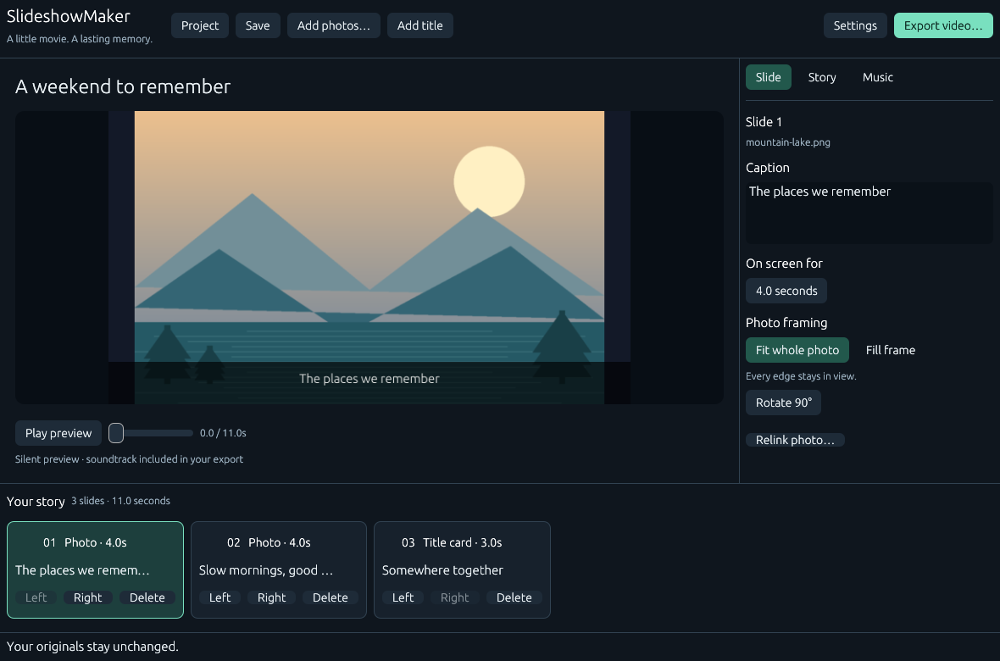
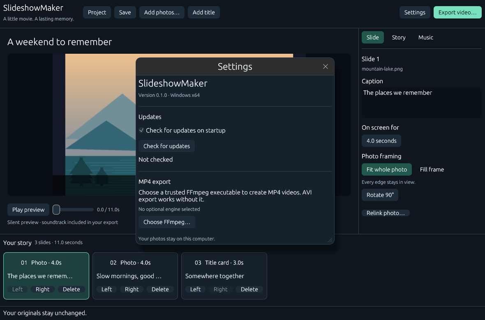
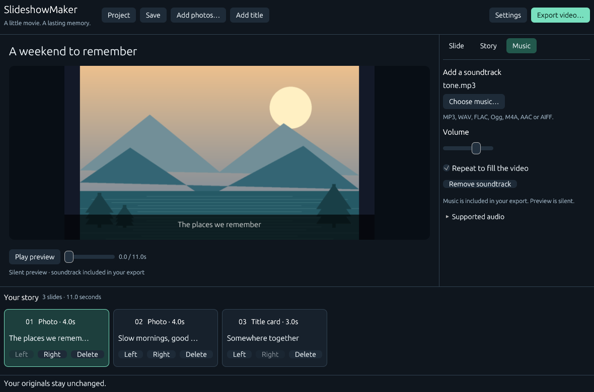

# SlideshowMaker

A small Windows photo-story editor for turning family photographs, captions and music into a video. Original implementation and templates, with no affiliation to SmartSHOW. Local processing; no accounts, AI services, bundled music, or automatic media uploads.

**Status:** first local implementation, version 0.1.0. Windows x64 is the initial packaging target. The interface uses CPU rasterization and Windows GDI. The planned [GitHub repository](https://github.com/siarheisinelnikau/slideshow-maker) and releases have not been published by this work.

## Create a video

1. Choose **Add photos** for JPEG, PNG, WebP or BMP images, or **Add title** for a title card.
2. Select a timeline card. In **Slide**, edit its caption, duration, rotation and framing. **Fit whole photo** preserves every edge; **Fill frame** deliberately crops from the center. JPEG orientation metadata is applied before your rotation.
3. Use **Left / Right** on the cards to reorder slides. In **Story**, choose landscape, portrait or square, a color template and a transition. You can proportionally fit the story to a total duration; transitions do not subtract from the total.
4. In **Music**, optionally choose a **MP3, WAV, FLAC, Ogg Vorbis, M4A, AAC or AIFF** soundtrack, adjust volume and enable repeat. Short tracks otherwise fade into silence.
5. Scrub or play the **silent** preview. Use **Save** for an editable `.slideshow.json` project; **Project** contains New, Open and Save as. Projects reference original media; keep those files available or use **Relink photo** after moving them.
6. Choose **Export video** for video size, file type and frame rate. Export **AVI** directly, or select your trusted FFmpeg executable in **Settings** for **MP4**. Choose a new destination filename. Export runs in the background with progress and cancellation.

Project files save atomically. Existing export files are never overwritten, including when cancellation or encoding fails. All media is read only. Save the project before closing or restarting to install an update.

## Video backend and limits

| Capability | 0.1.0 behavior |
| --- | --- |
| Built-in export | AVI 1.0, Motion JPEG, optional interleaved PCM16 audio; no external engine |
| Optional MP4 | Explicitly selected FFmpeg executable; MPEG-4 Part 2 video and AAC audio, `yuv420p`, fast-start metadata |
| Output sizes | Height 360, 720 or 1080; aspect ratio 16:9, 9:16 or 1:1; even pixel dimensions |
| Frame rates | 12, 24 or 30 fps |
| Timeline | Up to 500 slides, 0.5–120 seconds each, one hour total |
| Intermediate size | AVI is limited to 2 GB, including MP4's intermediate AVI |
| Input limits | JPEG/PNG/WebP/BMP; still frame of animated sources; transparency flattened over black; decoder allocation capped at 256 MiB, dimensions at 16,000 per side |
| Composition | Two-photo cache; oriented images scaled to at most 2048 per side; captions use embedded Ubuntu Light |
| Music input | Built-in MP3, WAV, FLAC, Ogg Vorbis, M4A (AAC-LC/ALAC), ADTS AAC-LC and AIFF decoding; mono/stereo, 8–96 kHz; 128 MiB file / 256 MiB decoded PCM limit |
| Not supported | Video-clip import, HEIC/RAW, recorded narration, sound playback, 3D effects, pan/zoom, undo/redo, portable project bundles |

Music needs no codec installation or external engine. WAV/AIFF integer PCM and floating-point samples are converted to PCM16 for export. Protected tracks, HE-AAC, Ogg Opus and surround sound are unsupported; choose an unprotected stereo track. Preview remains silent.

AVI can be played by many desktop media players; social and mobile services may require MP4. MPEG-4 Part 2 is not H.264 and is accepted by fewer sharing services. MP4 availability depends on the chosen FFmpeg build. Export temporarily needs disk space for AVI, MP4 when selected, and a final publication copy. Failed and cancelled jobs remove their temporary directory. A forced process termination may leave a temporary directory beside the selected output.

FFmpeg is **not bundled, installed or downloaded by SlideshowMaker**. Its optional MP4 conversion still requires separate verification; test audio fixtures were generated independently with an existing libVLC installation, without playback. Its license depends on how it was built; see [engine and asset notices](docs/THIRD_PARTY.md) before packaging one. No codecs, drivers or services are installed by SlideshowMaker.

## Build and package

Requires Rust 1.95 or newer and the Windows MSVC C++ build tools already installed. Dependencies are locked in `Cargo.lock`. The repository Cargo configuration limits jobs to two and uses a local `target` directory.

The Windows SDK resource compiler embeds the application's original 16–256 px icon and version metadata. The title bar and taskbar load matching DPI-appropriate images from the EXE. Icon source assets are in `assets`; regenerate them with `python scripts/generate-icon.py` when Pillow is already installed.

```powershell
cargo fmt --all -- --check
cargo check --locked --all-targets
cargo test --locked --all-targets
cargo clippy --locked --all-targets -- -D warnings
powershell -NoProfile -File scripts/package.ps1
```

Packaging statically links the MSVC runtime and produces `dist/SlideshowMaker-v0.1.0.exe`, its `.sha256`, and license notices. It does not launch the application or publish anything. The Windows UI uses egui CPU rasterization and softbuffer's GDI bitmap presentation; it does not create an OpenGL or Direct3D device. The event loop waits for input, worker results or animation deadlines, and unchanged window exposures reuse the retained bitmap. Windows desktop composition remains an operating-system responsibility. Additional DPI and clean-machine compatibility checks are listed in the validation record. PowerShell policy blocked running `.ps1` files in the initial session; the release build was invoked directly through Cargo without changing that policy.

For a safe, headless synthetic export (no UI, playback, or network):

```powershell
cargo run --locked --example render_fixture
python scripts/verify-fixture.py .test-output/synthetic.avi
```

The second command uses an **already installed** `opencv-python` decoder; it is optional and never installs packages. Repeated example runs choose a new AVI filename. Generated `.test-output` media is artificial and ignored by Git.

## Settings and updates

**Settings** shows the installed version, **Check for updates**, and a persistent **Check for updates on startup** toggle (enabled by default). Disabling it makes no update request at the next launch. Settings are stored under `%APPDATA%/SlideshowMaker/settings.json`. Startup checks use a separate bounded worker and do not block editing. A nonexistent repository/release, rate limit or network failure is reported as an unavailable check, never as “up to date”; startup errors remain in Settings without a popup.

A newer stable Windows x64 release needs `SlideshowMaker-vVERSION.exe` and `SlideshowMaker-vVERSION.exe.sha256` assets on the canonical repository. **Download and install** stages the official executable, checks its declared length, SHA-256 and x64 PE header, then offers **Restart to install update**. The shared native updater helper waits for the app to exit, replaces the portable executable, restarts it, and rolls back file-operation/start failures. No PowerShell script is needed. Project/media/settings paths are preserved. Read-only installations fail without elevation. The portable executable keeps its installed filename during updates. Checksum assets detect corrupt downloads; they are not a separate code-signing trust root.

Update installation and rollback have not been exercised. Startup-check persistence and native interaction still require interactive verification before publication. See [manual checks](docs/VALIDATION.md).

## Screenshots

These are application-generated captures of the real client area, using the same egui components, fonts and CPU rasterizer as the Windows application. They show original synthetic postcard media, not user photographs. Native title bars, file dialogs and mouse/keyboard behavior are outside these captures.







Additional verified views: [export options](docs/screenshots/export.png) and [empty editor at 900×640 logical pixels, 125% scale](docs/screenshots/empty-compact.png).

To reproduce the bounded captures with Python/Pillow already installed:

```powershell
python scripts/create-gui-fixtures.py
python scripts/capture-review.py dist/SlideshowMaker-v0.1.0.exe
```

Each capture starts a separate isolated process, uses no network or normal settings, renders three settled frames, writes PNG/metadata and exits. Direct invocation is also available:

```powershell
./dist/SlideshowMaker-v0.1.0.exe --screenshot E:/work/github/slideshow-maker/.test-output/review.png --screen settings --size 1180x780 --scale 1
```

For a separate bounded native rendering check, run `python scripts/verify-runtime.py dist/SlideshowMaker-v0.1.0.exe`. It samples visible idle, hidden and restored idle states, then exits automatically; it does not use computer use or simulate input. The recorded clean five-second samples each had zero UI layouts, rasterizations and presentations, and 0.00% CPU of one core at system-counter resolution. This supports idle/hidden efficiency, not a claim that subjective input responsiveness or GPU/compositor behavior has been fully verified.

See [architecture](docs/ARCHITECTURE.md), [validation](docs/VALIDATION.md), and [initial release draft](docs/RELEASE_NOTES.md). Source code is MIT licensed; embedded fonts and dependencies retain their licenses.

## Shared updater source

Build with Rust 1.95 or newer and keep `rust-auto-updator` beside this repository. Cargo uses `../rust-auto-updator/crates/rust-auto-updator`; the companion workspace is currently local and unpublished. A standalone clone/CI checkout must provision that source before building. `src/updater.rs` contains only this product's identity and checksum/staging configuration; release discovery, integrity checks, downloads, replacement, rollback and cleanup live in the companion core. The existing per-executable `.sha256` release contract and saved startup preference are preserved. Earlier versions' PowerShell helpers can still install this EXE and relaunch it without flags. Future versions use the shared `--apply-update` and `--cleanup-update` protocol.

Icon proof without launching the application: `python scripts/verify-icon-pixels.py dist/SlideshowMaker-v0.1.0.exe assets/SlideshowMaker.ico .test-output/icons.png` uses Pillow and the native resource-only loader plus DrawIconEx into memory bitmaps. It verifies nonblank native-sized frames on light/dark backgrounds; this is an icon resource proof, not an OS tray screenshot. SlideshowMaker intentionally has no tray icon.

Current migration evidence and runtime limits: [shared updater, icon and rendering audit](docs/UPDATER-AUDIT-2026-11-01.md).
