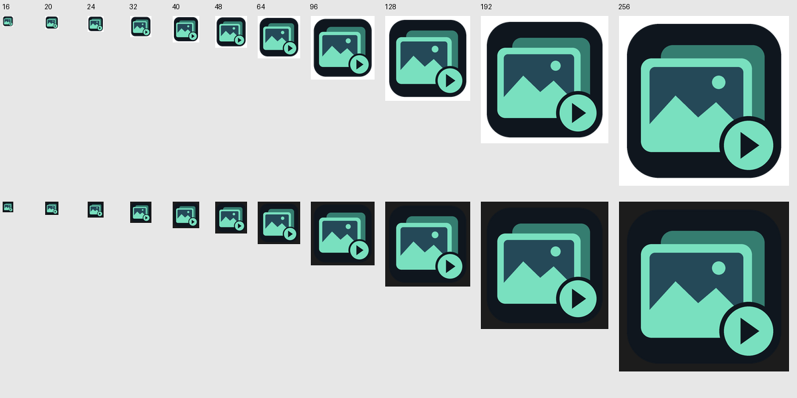

# Shared updater, icons and rendering audit — 2026-11-01

Reusable release selection, download integrity, same-volume staging, replacement, rollback and cleanup moved to the sibling `rust-auto-updator` core. The local adapter specifies SlideshowMaker's canonical identity, 256 MiB limit, per-executable checksum filename and staging names. Download/restart remain explicit actions; the persisted startup opt-out, save-before-restart guard and project/media paths are retained. The new EXE routes shared helper arguments before creating a GUI and performs cleanup after host initialization. `Prepared` owns abandoned staging files and hands them off only after a successful explicit install request. The duplicate PowerShell installation script was removed. An older version's already-running PowerShell helper can still replace this EXE and relaunch it without arguments.

## Icon proof

The actual optimized x64 EXE embeds matching original 32-bit frames at 16, 20, 24, 32, 40, 48, 64, 96, 128, 192 and 256px. `scripts/verify-release.py` checked exact source/resource payload equality, architecture, GUI subsystem, SHA-256 and the absence of imported MSVC redistributable or OpenGL/Direct3D DLLs. Resource-only `LoadLibraryExW` → `LoadImageW` → `DrawIconEx` memory bitmaps were inspected on light and dark backgrounds. All sizes contain visible artwork; the 16px mark occupies 14×14 visible pixels. No application process or native application window was created for this proof.

SlideshowMaker is a foreground editor and intentionally has no tray icon. Its existing native window/taskbar assignment loads resource group 1 at the DPI-appropriate small/large sizes and reloads on DPI changes. Actual OS assignment/caching on this new binary was not exercised in this task.

## Rendering and verification

The existing path is egui → optimized CPU rasterizer → retained bitmap → softbuffer Win32 GDI. No GPU rendering backend was introduced. The event loop uses Wait/WaitUntil, drops stale egui repaint requests and compares the scene before rasterizing/presenting unchanged content. This change additionally discards cosmetic repaint deadlines while hidden without losing dirty state needed on restore. Workers remain independently event driven; normal hidden windows do not run the UI renderer.

- `cargo fmt --all --check` passed.
- `cargo clippy --offline --locked --all-targets -j 1 -- -D warnings` passed; Cargo emitted only environment hard-link cache warnings.
- `cargo test --offline --locked --all-targets -j 1`: 21 tests passed, including product checksum/origin selection, pointer/scene settling and fractional texture bounds.
- Optimized x64 build with `-C target-feature=+crt-static` passed; the packaged artifact passed `scripts/verify-release.py`.
- No application launch, computer use, desktop input/capture, audio, update download/installation or publication occurred. The repository's code-only/no-launch instructions were respected.

Executable SHA-256: `a23e98eac70d973b8479c2362c073490b073fb16da15d1bd5c0884ec815f23ab`.

## Remaining limits

The new binary's idle/hidden/restore counters and real interaction smoothness remain unmeasured in this task because application launches are prohibited by AGENTS.md. Historical runtime samples in earlier validation documents belong to their earlier binary and are not a new pass. The source review, meaningful tests, optimized build and icon resource proof establish their own narrower results. Actual native window/taskbar integration, mixed-DPI transitions and live update/rollback require later bounded validation. Standalone/CI builds must provision the unpublished local companion workspace beside this repository; no remote checkout was invented.
